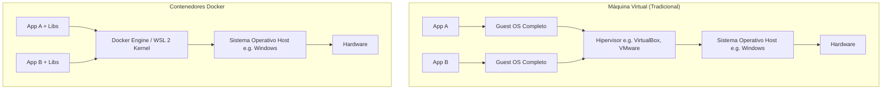

# Plan de Clase: Docker Desktop en Windows y Despliegue con Python & Flask

- **Institución:** Instituto Superior Tecnológico Yavirac
- **Asignatura:** Tendencias Actuales de Programación
- **Nivel:** Inicial / Intermedio
- **Modalidad:** Práctica en Laboratorio de Cómputo (Windows)
- **Duración:** 120 minutos (2 horas pedagógicas)

---

## 1. Objetivos de Aprendizaje

Al finalizar la sesión, los estudiantes estarán en capacidad de:
1. **Comprender la necesidad de la contenerización:** Explicar el problema *"en mi máquina sí funciona"* y cómo Docker estandariza entornos.
2. **Identificar la arquitectura básica:** Diferenciar con precisión entre **Imagen**, **Contenedor**, **Dockerfile** y **Docker Hub**.
3. **Verificar el entorno en Windows:** Validar el funcionamiento de Docker Desktop y su integración con WSL 2.
4. **Construir y empaquetar una aplicación:** Crear un servicio web en Python con Flask y redactar un `Dockerfile` optimizado.
5. **Gestionar ciclo de vida de contenedores:** Construir imágenes, mapear puertos (`-p`), consultar logs (`docker logs`), detener y reconstruir versiones modificadas.

---

## 2. Cronograma y Metodología (120 minutos)

| Tiempo | Minutos | Actividad | Metodología / Dinámica | Recursos y Entregables |
|---|---|---|---|---|
| **00:00 – 00:10** | 10 min | **Apertura:** El dilema de *"en mi PC sí funciona"* | Pregunta generadora y debate grupal guiado en pizarra | Pizarra / Diapositivas |
| **00:10 – 00:30** | 20 min | **Marco Conceptual:** Docker vs Máquinas Virtuales | Explicación teórica interactiva + Analogía de cocina | Diagramas de arquitectura |
| **00:30 – 00:45** | 15 min | **Verificación del Entorno:** Docker Desktop & WSL 2 | Demostración en vivo + `docker run hello-world` | Terminal PowerShell / CMD |
| **00:45 – 01:00** | 15 min | **Comandos Fundamentales de Docker** | Práctica guiada con comandos CLI y la GUI | Cheat Sheet de Docker |
| **01:00 – 01:30** | 30 min | **Laboratorio Central:** Crear y Contenerizar Flask | Desarrollo paso a paso: `app.py`, `requirements.txt`, `Dockerfile` | VS Code + Terminal |
| **01:30 – 01:50** | 20 min | **Desafío Práctico:** Modificar, Reconstruir y Puerto | Reto individual/parejas: actualizar mensaje y crear ruta `/saludo` | Navegador `localhost:5000` |
| **01:50 – 02:00** | 10 min | **Evaluación y Cierre:** Rúbrica y Preguntas Clave | Revisión de lista de cotejo y conclusiones de la clase | Rúbrica de evaluación |

---

## 3. Guión Pedagógico para el Docente

### Fase 1: Apertura y Motivación (0 - 10 min)
* **Situación de arranque:**
  > *"Imaginen que trabajan en equipo. Juan programa una API con Python 3.12 y librerías específicas en su laptop. Se la envía a María, pero en la laptop de María hay Python 3.9 y Windows genera un error de DLLs o dependencias no encontradas. ¿Qué hacen normalmente? ¿Cuánto tiempo se pierde instalando paquetes a mano?"*
* **Pregunta clave para el aula:** ¿Cómo garantizamos que el software se ejecute **exactamente igual** en desarrollo, en pruebas y en producción sin importar la computadora física?
* **Punto de anclaje:** Introducir el concepto de **Contenedor** como una caja autosuficiente y portátil.

---

### Fase 2: Teoría y Analogías Esenciales (10 - 30 min)

#### La Analogía de la Cocina:
Para que los estudiantes fijen la terminología técnica sin confusiones:
- **`Dockerfile`:** La **receta escrita** paso a paso (ingredientes, pasos de cocción).
- **Imagen (`Image`):** El **plato congelado / plantilla empaquetada** lista para usar (inmutable).
- **Contenedor (`Container`):** El **plato servido y caliente en la mesa** (la instancia viva ejecutándose).
- **Docker Hub / Registro:** El **supermercado o libro de recetas público** donde descargamos imágenes oficiales (`python`, `ubuntu`, `node`).

#### Diferencia Crítica: Docker vs Máquina Virtual



> [!NOTE]
> **Enfoque Windows con WSL 2:** Enfatizar que en Windows, Docker Desktop no virtualiza un Windows completo; utiliza una micro-máquina Linux ligera mediante **WSL 2** (*Windows Subsystem for Linux*), lo que otorga un rendimiento casi nativo sin consumir gigabytes innecesarios de RAM.

---

### Fase 3: Verificación Técnica del Laboratorio (30 - 45 min)

> [!IMPORTANT]
> **Recomendación didáctica de oro:** Solicitar a los alumnos que traigan instalado Docker Desktop antes de la clase o tener las máquinas del laboratorio listas con WSL 2 habilitado para evitar cuellos de botella de red durante la descarga del instalador (~600 MB).

#### Pasos de Verificación en Vivo:
1. Abrir PowerShell o CMD y ejecutar:
   ```powershell
   docker --version
   docker compose version
   docker info
   ```
2. Ejecutar la prueba de fuego:
   ```powershell
   docker run hello-world
   ```
3. Explicar lo que ocurre tras bambalinas:
   - Docker busca localmente `hello-world:latest`.
   - Al no encontrarla, la descarga (*pull*) desde Docker Hub.
   - Crea el contenedor, imprime el mensaje en terminal y finaliza su ejecución.

---

### Fase 4: Comandos Fundamentales (45 - 60 min)

Proyectar la terminal y Docker Desktop en paralelo. Demostrar cómo cada comando CLI se refleja instantáneamente en la interfaz gráfica:

```powershell
# Listar contenedores en ejecución
docker ps

# Listar todos los contenedores (incluyendo terminados)
docker ps -a

# Ver imágenes almacenadas localmente
docker images

# Limpiar contenedores detenidos de prueba
docker rm $(docker ps -a -q)  # o manualmente desde la GUI
```

---

### Fase 5: Laboratorio Paso a Paso - Hola Mundo con Flask (60 - 90 min)

Guiar a los estudiantes a construir el proyecto desde cero en la carpeta `hola-flask`.

#### Estructura del Proyecto:
```text
hola-flask/
├── app.py              # Código de la aplicación web Flask
├── requirements.txt    # Definición de dependencias
└── Dockerfile          # Especificación de construcción de la imagen
```

#### Puntos Críticos a Explicar:
1. **`host="0.0.0.0"` en `app.py`:**
   Si Flask escucha por defecto en `127.0.0.1`, sólo acepta peticiones *internas* dentro del contenedor. Con `0.0.0.0` escucha en todas las interfaces de red del contenedor, permitiendo que el mapeo de puertos de Docker funcione hacia Windows.
2. **Anatomía del `Dockerfile`:**
   Diferenciar rigurosamente entre **`RUN`** (se ejecuta en tiempo de construcción para armar la imagen) y **`CMD`** (se ejecuta en tiempo de arranque del contenedor).
3. **Mapeo de Puertos `-p 5000:5000`:**
   - Primer número (`5000`): Puerto en el **Host (Windows)**.
   - Segundo número (`5000`): Puerto dentro del **Contenedor**.

---

### Fase 6: Reto Práctico y Reconstrucción (90 - 110 min)

Demostrar que modificar `app.py` en Windows **no altera** el contenedor en marcha:
1. Cambiar el texto HTML en `app.py`.
2. Refrescar el navegador: ¡Sigue mostrando el texto anterior!
3. **Lección clave:** La imagen es inmutable. Para aplicar cambios se debe:
   ```powershell
   # 1. Reconstruir la imagen
   docker build -t hola-flask .

   # 2. Detener y borrar el contenedor viejo
   docker rm -f hola-flask

   # 3. Lanzar el nuevo contenedor
   docker run -d --name hola-flask -p 5000:5000 hola-flask
   ```
4. **Reto para los alumnos:** Agregar una ruta `@app.route("/saludo/<nombre>")` o `@app.route("/saludo")` y validar en el navegador.

---

### Fase 7: Evaluación y Preguntas de Cierre (110 - 120 min)

Hacer una ronda de preguntas de consolidación:
1. ¿Cuál es la diferencia entre una imagen y un contenedor?
2. ¿Por qué el archivo se debe llamar `Dockerfile` sin extensión `.txt`?
3. Si elimino un contenedor con `docker rm`, ¿se borra la imagen descargada?
4. ¿Qué ventaja ofrece correr Flask en Docker frente a instalarlo en Windows con `pip install flask`?

---

## 4. Instrumento de Evaluación (Rúbrica / Lista de Cotejo)

| Criterio | Indicador de Logro | Puntaje (1 a 5) |
|---|---|:---:|
| **1. Entorno y Verificación** | Verifica Docker Desktop y ejecuta exitosamente `docker run hello-world`. | / 5 |
| **2. Estructura de Proyecto** | Configura correctamente `app.py` (con `0.0.0.0`) y `requirements.txt`. | / 5 |
| **3. Dockerfile Correcto** | Redacta las directivas (`FROM`, `WORKDIR`, `COPY`, `RUN`, `EXPOSE`, `CMD`) sin errores de sintaxis. | / 5 |
| **4. Construcción y Ejecución** | Construye la imagen (`docker build`) y ejecuta el contenedor en segundo plano con mapeo de puertos (`-p 5000:5000`). | / 5 |
| **5. Ciclo de Modificación y Reto** | Modifica el código, reconstruye la imagen, recrea el contenedor y resuelve el reto de la ruta `/saludo`. | / 5 |
| **Total** | | **/ 25 pts** |
