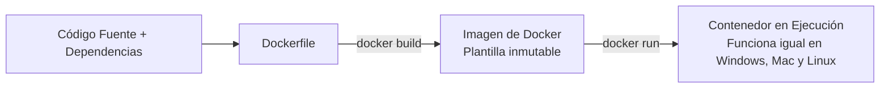

# Guía Práctica de Laboratorio: Docker Desktop en Windows y Despliegue con Python & Flask

> **Asignatura:** Tendencias Actuales de Programación  
> **Nivel:** Inicial  
> **Modalidad:** Taller Práctico (Windows 10 / 11)  
> **Tiempo Estimado:** 120 minutos  

---

## Índice de Contenidos
1. [Introducción: ¿Por qué necesitamos Docker?](#1-introducción-por-qué-necesitamos-docker)
2. [Conceptos Clave de Docker](#2-conceptos-clave-de-docker)
3. [Instalación y Verificación en Windows](#3-instalación-y-verificación-en-windows)
4. [Explorando Docker Desktop](#4-explorando-docker-desktop)
5. [Desarrollo del Proyecto Hola Mundo con Flask](#5-desarrollo-del-proyecto-hola-mundo-con-flask)
6. [Creación del Dockerfile](#6-creación-del-dockerfile)
7. [Construcción y Despliegue del Contenedor](#7-construcción-y-despliegue-del-contenedor)
8. [Ciclo de Actualización: Modificar y Reconstruir](#8-ciclo-de-actualización-modificar-y-reconstruir)
9. [Resolución de Problemas Frecuentes](#9-resolución-de-problemas-frecuentes)
10. [Reto Práctico Evaluado](#10-reto-práctico-evaluado)

---

## 1. Introducción: ¿Por qué necesitamos Docker?

En el desarrollo tradicional de software es muy común toparse con el famoso problema:

> 🗣️ *"¡En mi computadora sí funciona, pero en la del profesor o en el servidor se cae!"*

Esto ocurre porque cada computadora tiene configuraciones diferentes: versiones distintas de Python, paquetes faltantes, variables de entorno que no coinciden o problemas de compatibilidad del sistema operativo.

### La Solución: Contenedores
**Docker** resuelve este problema empaquetando la aplicación junto con su código, sus bibliotecas, sus dependencias y su configuración exacta dentro de un entorno aislado y reproducible denominado **Contenedor**.



---

## 2. Conceptos Clave de Docker

Para dominar Docker, debes entender cuatro conceptos fundamentales:

| Concepto | Definición | Analogía de Cocina |
|---|---|---|
| **Dockerfile** | Archivo de texto plano con las instrucciones paso a paso para armar el entorno. | La **receta de cocina** escrita. |
| **Imagen (`Image`)** | Paquete inmutable que contiene el sistema base, las librerías y el código listo para correr. | El **pastel terminado o congelado**. |
| **Contenedor (`Container`)** | Una instancia viva y en ejecución de una imagen. Se puede iniciar, pausar o destruir. | El **pastel servido en la mesa**. |
| **Docker Hub** | Registro público en la nube donde desarrolladores y empresas comparten imágenes listas. | El **supermercado** de ingredientes y recetas. |

### Docker vs Máquinas Virtuales (VM)

| Característica | Docker (Contenedores) | Máquina Virtual Tradicional |
|---|---|---|
| **Sistema Operativo** | Comparte el kernel del sistema anfitrión (mediante WSL 2 en Windows). | Ejecuta un sistema operativo invitado completo (*Guest OS*). |
| **Consumo de Recursos** | Muy ligero (pocos megabytes de RAM y arranque en segundos). | Pesado (requiere gigabytes de RAM y varios minutos para iniciar). |
| **Aislamiento** | Aislamiento a nivel de procesos y espacios de nombres (*namespaces*). | Aislamiento completo por hipervisor de hardware. |

---

## 3. Instalación y Verificación en Windows

### Requisitos Previos:
- Windows 10 (64-bit: Pro, Enterprise o Home versión 21H2 o superior) o Windows 11.
- Virtualización habilitada en la BIOS/UEFI del procesador (Intel VT-x o AMD-V).
- Mínimo 8 GB de memoria RAM recomendados.

### Paso 1: Instalación de WSL 2
Docker Desktop en Windows utiliza el motor **WSL 2 (Windows Subsystem for Linux)**.  
Abre **PowerShell como Administrador** y ejecuta:

```powershell
wsl --install
wsl --update
```
> [!NOTE]
> Si el sistema te solicita reiniciar el equipo, reinicia antes de continuar.

### Paso 2: Descargar e Instalar Docker Desktop
1. Descarga el instalador oficial desde: [Docker Desktop para Windows](https://docs.docker.com/desktop/setup/install/windows-install/).
2. Ejecuta el archivo descargado y asegúrate de marcar la opción **"Use WSL 2 instead of Hyper-V (recommended)"**.
3. Una vez finalizada la instalación, abre Docker Desktop desde el menú Inicio de Windows y espera a que el icono en la barra de tareas cambie a verde (Engine Running).

### Paso 3: Verificación en Terminal
Abre PowerShell o CMD y ejecuta:

```powershell
# 1. Comprobar la versión instalada del cliente y motor
docker --version

# 2. Comprobar la herramienta Docker Compose
docker compose version

# 3. Comprobar información general del sistema Docker
docker info
```

### Paso 4: Ejecutar el primer contenedor de prueba
Ejecuta el siguiente comando para comprobar que Docker se comunica con Docker Hub:

```powershell
docker run hello-world
```

**¿Qué hace este comando?**
1. Docker busca la imagen `hello-world` en tu equipo local.
2. Como no existe, la descarga desde Docker Hub.
3. Crea un contenedor a partir de esa imagen.
4. El contenedor imprime en pantalla el mensaje:  
   `Hello from Docker! This message shows that your installation appears to be working correctly.`
5. El contenedor finaliza automáticamente.

---

## 4. Explorando Docker Desktop

Docker Desktop te brinda una interfaz gráfica para administrar tus recursos sin necesidad de recordar todos los comandos.

```
+-----------------------------------------------------------+
| DOCKER DESKTOP                                     [_][X] |
+-----------------------------------------------------------+
|  [Containers]   > hola-flask (Running)  Port: 5000:5000   |
|  [Images]       > hola-flask (Latest)   Size: 170MB       |
|  [Volumes]      > (Almacenamiento persistente)            |
|  [Extensions]   > Extensiones y utilidades                |
+-----------------------------------------------------------+
```

### Comandos de Terminal Más Usados:

```powershell
# Ver contenedores actualmente en ejecución
docker ps

# Ver TODOS los contenedores (activos y detenidos)
docker ps -a

# Ver las imágenes descargadas y construidas localmente
docker images

# Ver los mensajes/logs de la aplicación
docker logs <nombre-contenedor>

# Detener un contenedor
docker stop <nombre-contenedor>

# Iniciar un contenedor previamente detenido
docker start <nombre-contenedor>

# Forzar la eliminación de un contenedor
docker rm -f <nombre-contenedor>

# Eliminar una imagen local
docker rmi <nombre-imagen>
```

---

## 5. Desarrollo del Proyecto Hola Mundo con Flask

Vamos a crear una aplicación web con Python y el framework Flask.

> [!IMPORTANT]
> **No necesitas instalar Python ni Flask en tu máquina Windows.** Todo se instalará y ejecutará de forma aislada dentro del contenedor.

### Paso 1: Crear la carpeta de trabajo
Abre PowerShell o CMD y ejecuta:

```powershell
mkdir d:\YAVIRAC\tendencias\hola-flask
cd d:\YAVIRAC\tendencias\hola-flask
```
*(O en la carpeta que indique tu docente).*

Abre esta carpeta en **Visual Studio Code**:
```powershell
code .
```

### Paso 2: Crear el archivo de código `app.py`
Crea un archivo llamado `app.py` con el siguiente código:

```python
from flask import Flask

app = Flask(__name__)

@app.route("/")
def inicio():
    return """
    <!DOCTYPE html>
    <html lang="es">
    <head>
        <meta charset="UTF-8">
        <title>Mi Primer Docker con Flask</title>
        <style>
            body { font-family: 'Segoe UI', Tahoma, Geneva, Verdana, sans-serif; background-color: #f4f6f9; text-align: center; padding: 50px; }
            .card { background: white; border-radius: 12px; padding: 40px; box-shadow: 0 4px 12px rgba(0,0,0,0.1); display: inline-block; }
            h1 { color: #0db7ed; }
            p { color: #333; font-size: 1.1em; }
            .badge { background: #28a745; color: white; padding: 6px 14px; border-radius: 20px; font-weight: bold; }
        </style>
    </head>
    <body>
        <div class="card">
            <h1>¡Hola Mundo con Docker y Flask! 🐳</h1>
            <p>Mi primera aplicación web contenerizada.</p>
            <span class="badge">Ejecutándose en un contenedor Linux con WSL 2</span>
        </div>
    </body>
    </html>
    """

if __name__ == "__main__":
    # Importante: host="0.0.0.0" permite conexiones externas al contenedor
    app.run(host="0.0.0.0", port=5000)
```

#### Análisis del código:
- `@app.route("/")`: Asocia la URL raíz del servidor con la función `inicio()`.
- `host="0.0.0.0"`: **Regla indispensable en Docker.** Si dejas `127.0.0.1`, Flask solo aceptará peticiones locales dentro de su propia red interna y no podrás acceder desde tu navegador en Windows.
- `port=5000`: Puerto de red en el que escuchará el servidor de Flask.

### Paso 3: Crear el archivo de dependencias `requirements.txt`
Crea el archivo `requirements.txt`:

```text
Flask==3.1.2
```

Este archivo le indica a la herramienta `pip` de Python qué bibliotecas exactas debe descargar e instalar.

---

## 6. Creación del Dockerfile

Crea un archivo llamado exactamente **`Dockerfile`** (sin extensión `.txt`, `.py` ni ninguna otra).

Escribe el siguiente contenido:

```dockerfile
# 1. Imagen base oficial de Python ligera basada en Debian Linux
FROM python:3.12-slim

# 2. Definir el directorio de trabajo dentro del contenedor
WORKDIR /app

# 3. Copiar la lista de dependencias al contenedor
COPY requirements.txt .

# 4. Instalar las dependencias de Python sin guardar caché para reducir el tamaño
RUN pip install --no-cache-dir -r requirements.txt

# 5. Copiar el código fuente de nuestra aplicación
COPY app.py .

# 6. Documentar el puerto que expone el contenedor
EXPOSE 5000

# 7. Comando que se ejecutará al iniciar el contenedor
CMD ["python", "app.py"]
```

### Explicación de cada instrucción del Dockerfile:

| Instrucción | Propósito técnico |
|---|---|
| `FROM python:3.12-slim` | Descarga la imagen base oficial de Python 3.12 optimizada (*slim* pesa ~130MB en lugar de ~1GB). |
| `WORKDIR /app` | Crea y se posiciona en la carpeta `/app` dentro del contenedor. Todos los comandos siguientes se ejecutarán allí. |
| `COPY requirements.txt .` | Copia el archivo desde Windows a la carpeta actual del contenedor (`/app`). |
| `RUN pip install ...` | Se ejecuta **durante la construcción** de la imagen para instalar Flask. |
| `COPY app.py .` | Copia el script de la aplicación a la imagen. |
| `EXPOSE 5000` | Documenta que el contenedor utilizará el puerto 5000 (buena práctica informativa). |
| `CMD ["python", "app.py"]` | Indica el comando predeterminado que debe arrancar cuando el contenedor sea encendido. |

> [!TIP]
> **Diferencia entre RUN y CMD:**
> - `RUN` se ejecuta **una sola vez** al crear la imagen (ej: instalar programas, descargar paquetes).
> - `CMD` es la instrucción que se ejecuta **cada vez** que creas o inicias el contenedor.

---

## 7. Construcción y Despliegue del Contenedor

### Paso 1: Construir la imagen
Asegúrate de estar en la terminal dentro de la carpeta donde se encuentra tu `Dockerfile` y ejecuta:

```powershell
docker build -t hola-flask .
```

- `-t hola-flask`: Le asigna una etiqueta o nombre a la imagen (*tag*).
- `.`: El punto al final indica el **contexto de construcción** (la carpeta actual).

Para verificar que la imagen fue creada:
```powershell
docker images
```
Verás en la lista una imagen con el repositorio `hola-flask`.

---

### Paso 2: Ejecutar el contenedor
Lanza el contenedor con el siguiente comando:

```powershell
docker run -d --name hola-flask -p 5000:5000 hola-flask
```

#### Anatomía del comando:

```
  docker run   -d   --name hola-flask   -p 5000:5000   hola-flask
      │        │           │                 │             │
      │        │           │                 │             └─ Nombre de la imagen base
      │        │           │                 └─ Mapeo de puertos [Puerto Host]:[Puerto Contenedor]
      │        │           └─ Nombre asignado a este contenedor vivo
      │        └─ Modo desacoplado (Background / Segundo plano)
      └─ Instrucción para crear y arrancar el contenedor
```

---

### Paso 3: Probar la aplicación en el navegador
Abre tu navegador web favorito (Chrome, Edge, Firefox) e ingresa a:

👉 **[http://localhost:5000](http://localhost:5000)**

Deberías ver la página web con el mensaje de ¡Hola Mundo! y el distintivo de ejecución dentro de Docker.

---

### Paso 4: Monitoreo desde la Terminal y Docker Desktop

1. **Ver los logs (mensajes de Flask):**
   ```powershell
   docker logs hola-flask
   ```
2. **Seguir los logs en tiempo real (modo escucha):**
   ```powershell
   docker logs -f hola-flask
   ```
   *(Presiona `Ctrl + C` para salir).*
3. **Revisar en Docker Desktop:**
   Abre la ventana de Docker Desktop, haz clic en **Containers** y observa tu contenedor `hola-flask` en color verde (*Running*). Puedes pausarlo, reiniciarlo o inspeccionar sus estadísticas de memoria y CPU.

---

## 8. Ciclo de Actualización: Modificar y Reconstruir

> [!WARNING]
> Recuerda: **Las imágenes de Docker son inmutables**. Si cambias tu código en `app.py`, el contenedor que ya está corriendo **NO** se actualizará automáticamente.

### Prueba Práctica:
1. Abre `app.py` en VS Code y modifica el texto del título:
   ```python
   <h1>¡Hola Mundo desde Docker Desktop Actualizado! 🚀</h1>
   <p>Curso: Tendencias Actuales de Programación - YAVIRAC</p>
   ```
2. Guarda el archivo (`Ctrl + S`) y recarga la página en el navegador (`F5`).  
   👉 **Notarás que el cambio NO aparece.** ¿Por qué? Porque el contenedor sigue ejecutando la copia del archivo que se empaquetó en la imagen original.

### Procedimiento para desplegar la nueva versión:

```powershell
# 1. Reconstruir la imagen con el nuevo código
docker build -t hola-flask .

# 2. Detener y eliminar el contenedor antiguo
docker rm -f hola-flask

# 3. Levantar el nuevo contenedor con la imagen actualizada
docker run -d --name hola-flask -p 5000:5000 hola-flask
```

Ahora recarga el navegador con **`Ctrl + F5`** y verás la versión actualizada.

---

## 9. Resolución de Problemas Frecuentes

| Síntoma / Error | Causa Probable | Solución |
|---|---|---|
| `'docker' no se reconoce como un comando interno o externo` | Docker Desktop no está instalado o no se agregaron sus binarios a la variable `PATH`. | Reinicia la terminal. Si persiste, reinicia Windows o reinstala Docker Desktop. |
| `error during connect: In the default daemon configuration on Windows...` | El motor de Docker Desktop está detenido o cargando. | Abre Docker Desktop desde el menú Inicio y espera a que indique *Engine running*. |
| `Error response from daemon: Conflict. The container name "/hola-flask" is already in use` | Ya existe un contenedor con ese nombre. | Ejecuta `docker rm -f hola-flask` antes de volver a crearlo con `docker run`. |
| `bind: address already in use` o `port is already allocated` | El puerto 5000 de tu Windows está siendo ocupado por otro programa. | Cambia el puerto del anfitrión: `docker run -d --name hola-flask -p 5001:5000 hola-flask` y abre `http://localhost:5001`. |
| El navegador dice *"No se puede acceder a este sitio"* | En `app.py` olvidaste poner `host="0.0.0.0"` o el contenedor se cayó. | Revisa los logs con `docker logs hola-flask` y verifica que `app.run(host="0.0.0.0", port=5000)` esté presente. |
| `COPY failed: file not found` al construir la imagen | El archivo `app.py` o `requirements.txt` no está en la misma carpeta que el `Dockerfile`. | Verifica con el comando `dir` en la terminal que los 3 archivos estén en la misma carpeta. |
| El archivo se guardó como `Dockerfile.txt` | El Bloc de notas o Windows ocultó las extensiones conocidas y agregó `.txt`. | En el Explorador de Windows activa la casilla *Vista > Extensiones de nombre de archivo* y elimina el `.txt`. |

---

## 10. Reto Práctico Evaluado

Para demostrar tu aprendizaje, realiza el siguiente reto:

1. **Nueva ruta en Flask:**
   Agrega una nueva ruta `/saludo/<nombre>` en `app.py` que reciba un parámetro y retorne un saludo personalizado:
   ```python
   @app.route("/saludo/<nombre>")
   def saludar(nombre):
       return f"<h2>¡Bienvenido/a a Docker, {nombre}! 🚀</h2>"
   ```
2. **Reconstruye la imagen y reinicia el contenedor.**
3. **Evidencias solicitadas por el docente:**
   - Captura de pantalla del navegador en `http://localhost:5000/saludo/TuNombre`.
   - Captura de la terminal con la salida de `docker ps`.
   - Captura de Docker Desktop mostrando el contenedor activo.
