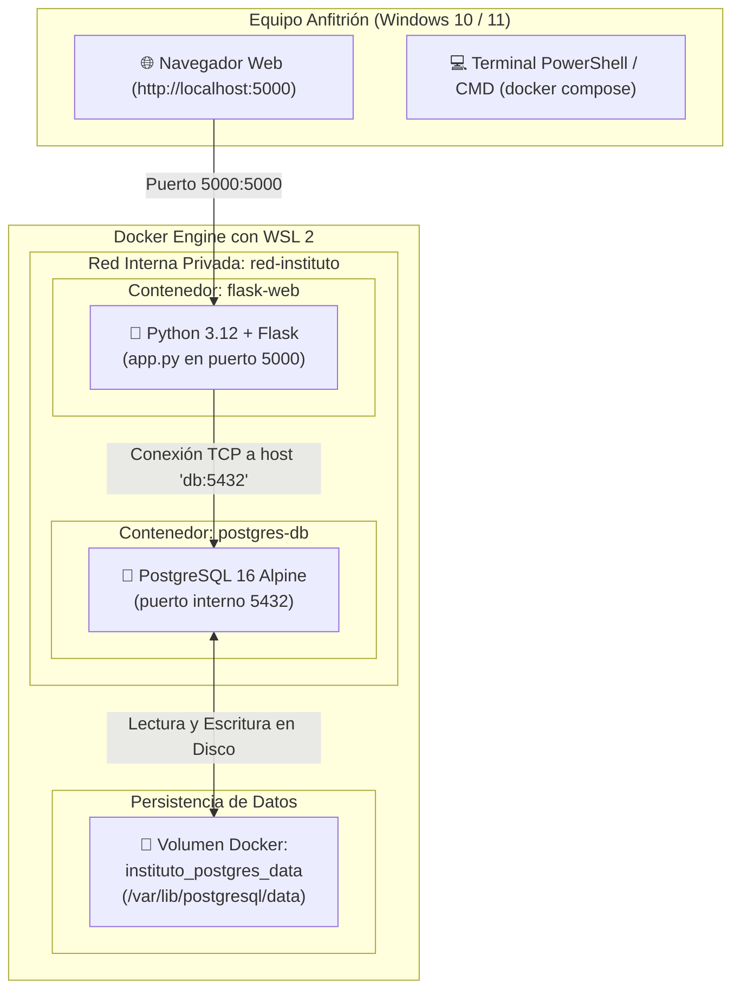

# Guía Práctica Semana 2: Aplicación Web Python (Flask) + Base de Datos PostgreSQL con Docker Compose

- **Institución:** Instituto Superior Tecnológico Yavirac  
- **Asignatura:** Tendencias Actuales de Programación  
- **Nivel:** Inicial – Intermedio  
- **Modalidad:** Taller Práctico de Laboratorio (Windows 10 / 11)  
- **Duración Estimada:** 120 minutos (2 horas)  

---

## 🎯 1. Objetivos de Aprendizaje

Al finalizar esta sesión de laboratorio, los estudiantes estarán en capacidad de:
1. **Comprender la arquitectura multi-contenedor:** Explicar por qué la aplicación web y la base de datos deben aislarse en contenedores separados.
2. **Dominar Docker Compose:** Orquestar múltiples servicios interconectados utilizando un archivo declarativo `docker-compose.yml`.
3. **Entender las Redes en Docker (DNS interno):** Comprender cómo dos contenedores se comunican por el nombre del servicio (`db:5432`) sin depender de direcciones IP fijas.
4. **Garantizar la persistencia de datos (Volúmenes):** Demostrar que los datos de PostgreSQL no se pierden al apagar o destruir los contenedores.
5. **Programar la integración Python-PostgreSQL:** Conectar Flask con la base de datos mediante `psycopg2-binary`, ejecutar consultas SQL seguras (evitando inyecciones SQL) y manejar reintentos de conexión.

---

## 🧠 2. Fundamento Teórico: De un Solo Contenedor a Multi-Contenedor

En la **Semana 1** aprendimos a empaquetar una aplicación web sencilla en un único contenedor. Sin embargo, en el mundo real, los sistemas modernos no meten todo en una sola caja.

### ¿Por qué no meter PostgreSQL y Flask en el mismo contenedor?
1. **Principio de Responsabilidad Única:** Un contenedor debe tener un único proceso principal (`1 contenedor = 1 servicio`).
2. **Escalabilidad independiente:** Si la web recibe miles de visitas, podemos crear 5 réplicas del contenedor de Flask sin necesidad de duplicar 5 veces la base de datos.
3. **Mantenimiento y actualizaciones:** Puedes actualizar la versión de Python sin reiniciar ni arriesgar los datos de la base de datos.
4. **Desacoplamiento:** Facilita cambiar de base de datos o migrar a servicios en la nube en el futuro.

---

## 🏗️ 3. Diagrama de Arquitectura de la Solución



---

## 🔑 4. Los Tres Pilares de Docker Compose en esta Clase

### 1. El Servicio (`services`)
En `docker-compose.yml` definimos qué aplicaciones queremos levantar:
- **`web`:** Construido desde nuestro `Dockerfile` local con Python y Flask.
- **`db`:** Descargado directamente desde Docker Hub (`postgres:16-alpine`), optimizado y ligero.

### 2. La Red y el DNS Interno (`networks`)
¿Cómo sabe Flask en qué dirección IP está PostgreSQL si Docker asigna IPs dinámicas?  
👉 **Por el nombre del servicio.** Docker incluye un servidor DNS interno. Dentro de la red de Docker, escribir `host="db"` apunta automáticamente a la IP privada del contenedor de PostgreSQL.

> [!IMPORTANT]
> **Error común de principiante:** Escribir `host="localhost"` en Python dentro del contenedor.  
> Recuerda: para el contenedor web, `localhost` es **él mismo**, ¡no la base de datos! Debe usarse `host="db"`.

### 3. El Volumen Persistente (`volumes`)
Los contenedores son **efímeros por naturaleza**: si borras un contenedor sin volumen, todo lo que guardaste dentro desaparece.  
Un **Volumen de Docker** es una carpeta especial administrada por el motor de Docker en el disco físico que sobrevive al ciclo de vida del contenedor. Aunque destruyas el contenedor `postgres-db`, los datos permanecen a salvo.

---

## 📁 5. Estructura de Archivos del Proyecto

Dentro de la carpeta `d:\YAVIRAC\tendencias\semana 2`:

```text
semana 2/
├── app.py                # Aplicación Flask + consultas SQL con psycopg2
├── requirements.txt      # Dependencias (Flask y psycopg2-binary)
├── Dockerfile            # Instrucciones para empaquetar la app Python
├── docker-compose.yml    # Orquestación de Flask + PostgreSQL + Volúmenes
├── .dockerignore         # Archivos que no se envían a la imagen Docker
├── README.md             # Comandos de inicio rápido
└── GUIA_SEMANA_2.md      # Este manual de estudio completo
```

---

## 💻 6. Explicación Detallada del Código

### Archivo 1: `requirements.txt`
```text
Flask==3.1.2
psycopg2-binary==2.9.10
```
- `Flask`: Microframework para crear la aplicación web y rutas HTTP.
- `psycopg2-binary`: Controlador oficial y de alto rendimiento en C/Python para comunicarse con bases de datos PostgreSQL.

---

### Archivo 2: `Dockerfile`
```dockerfile
# 1. Usar imagen base ligera oficial de Python
FROM python:3.12-slim

# 2. Carpeta de trabajo dentro del contenedor
WORKDIR /app

# 3. Copiar primero las dependencias para aprovechar la memoria caché de Docker
COPY requirements.txt .

# 4. Instalar las librerías necesarias
RUN pip install --no-cache-dir -r requirements.txt

# 5. Copiar el código fuente de la aplicación
COPY app.py .

# 6. Documentar el puerto que utiliza Flask
EXPOSE 5000

# 7. Ejecutar la aplicación al encender el contenedor
CMD ["python", "app.py"]
```

---

### Archivo 3: `docker-compose.yml`
```yaml
services:
  # Servicio 1: Base de datos PostgreSQL
  db:
    image: postgres:16-alpine
    container_name: postgres-db
    restart: unless-stopped
    environment:
      POSTGRES_DB: instituto_db
      POSTGRES_USER: postgres
      POSTGRES_PASSWORD: postgres123
    ports:
      - "5432:5432"
    volumes:
      - postgres_data:/var/lib/postgresql/data
    networks:
      - red-instituto

  # Servicio 2: Aplicación Web Python + Flask
  web:
    build: .
    container_name: flask-web
    restart: unless-stopped
    ports:
      - "5000:5000"
    environment:
      DB_HOST: db
      DB_NAME: instituto_db
      DB_USER: postgres
      DB_PASSWORD: postgres123
      DB_PORT: 5432
    depends_on:
      - db
    networks:
      - red-instituto

volumes:
  postgres_data:
    name: instituto_postgres_data

networks:
  red-instituto:
    driver: bridge
```

#### Elementos clave a resaltar:
- **`depends_on: - db`:** Le dice a Docker que inicie primero el contenedor de PostgreSQL antes de levantar el de Flask.
- **`environment:`** Pasa credenciales y configuración sin tener que escribirlas fijas en el código de Python.
- **`volumes: - postgres_data:/var/lib/postgresql/data`:** Mapea el directorio interno de datos de PostgreSQL al volumen persistente de Docker.

---

### Archivo 4: `app.py` (Lógica de Python)
Puntos destacados del código:

1. **Reintento de conexión automática:**  
   Cuando Docker inicia ambos contenedores, PostgreSQL tarda 2 o 3 segundos en inicializar sus archivos en disco. El bucle de reintento evita que Flask se caiga con un error de conexión inicial:
   ```python
   def get_db_connection(max_reintentos=5, espera=2):
       intentos = 0
       while intentos < max_reintentos:
           try:
               return psycopg2.connect(...)
           except psycopg2.OperationalError:
               intentos += 1
               time.sleep(espera)
   ```

2. **Creación automática de tabla (`DDL`):**
   ```sql
   CREATE TABLE IF NOT EXISTS estudiantes (
       id SERIAL PRIMARY KEY,
       nombre VARCHAR(100) NOT NULL,
       correo VARCHAR(100) NOT NULL,
       carrera VARCHAR(100) NOT NULL,
       fecha_registro TIMESTAMP DEFAULT CURRENT_TIMESTAMP
   );
   ```

3. **Consultas parametrizadas (Seguridad contra Inyección SQL):**
   ```python
   cur.execute(
       "INSERT INTO estudiantes (nombre, correo, carrera) VALUES (%s, %s, %s);",
       (nombre, correo, carrera)
   )
   ```

---

## 🚀 7. Guía Práctica de Ejecución en Windows (Paso a Paso)

Abre **PowerShell** o **Windows Terminal** y sigue estos pasos:

### Paso 1: Ubicarse en el directorio del proyecto
```powershell
cd "d:\YAVIRAC\tendencias\semana 2"
```

### Paso 2: Construir y levantar los contenedores con Docker Compose
Ejecuta el siguiente comando:
```powershell
docker compose up --build -d
```

**¿Qué significan estas opciones?**
- `up`: Crea y arranca los contenedores, redes y volúmenes definidos.
- `--build`: Fuerza la construcción de la imagen de Flask si hay cambios.
- `-d`: *(Detached)* Ejecuta los contenedores en segundo plano, liberando tu terminal.

---

### Paso 3: Verificar que ambos contenedores estén corriendo
```powershell
docker compose ps
```
Deberías ver una salida similar a esta:
```text
NAME          IMAGE                COMMAND                  SERVICE   CREATED          STATUS          PORTS
flask-web     semana2-web          "python app.py"          web       15 seconds ago   Up 14 seconds   0.0.0.0:5000->5000/tcp
postgres-db   postgres:16-alpine   "docker-entrypoint.s…"   db        15 seconds ago   Up 14 seconds   0.0.0.0:5432->5432/tcp
```
Ambos deben tener el estado **`Up`**.

---

### Paso 4: Probar la aplicación en el navegador
Abre tu navegador en:
👉 **[http://localhost:5000](http://localhost:5000)**

Verás la interfaz con el formulario de registro:
1. Ingresa un nombre: `Ana Morales`.
2. Ingresa un correo: `ana.morales@yavirac.edu.ec`.
3. Selecciona la carrera: `Desarrollo de Software`.
4. Haz clic en **Guardar en PostgreSQL**.

¡El registro aparecerá de inmediato en la tabla inferior!

---

### Paso 5: Consultar los registros directamente en PostgreSQL desde la Terminal
Demuestra a los estudiantes que el dato realmente viajó y se guardó en la base de datos PostgreSQL:

Abre una sesión interactiva con el cliente `psql` dentro del contenedor:
```powershell
docker exec -it postgres-db psql -U postgres -d instituto_db
```

Dentro del prompt de PostgreSQL (`instituto_db=#`), ejecuta:
```sql
-- 1. Listar las tablas existentes
\dt

-- 2. Consultar los registros guardados
SELECT * FROM estudiantes;

-- 3. Salir de PostgreSQL
\q
```

---

## 🧪 8. La Prueba de Fuego: Validar la Persistencia de Datos

Para que los estudiantes comprendan el verdadero valor de los **Volúmenes de Docker**:

### 1. Detener y ELIMINAR los contenedores
Ejecuta:
```powershell
docker compose down
```
> *Observa que los contenedores `flask-web` y `postgres-db` son eliminados por completo.*

### 2. Volver a encender todo
```powershell
docker compose up -d
```

### 3. Recargar el navegador (`http://localhost:5000`)
👉 **¡Los estudiantes registrados siguen ahí!**  
Los datos no estaban dentro del contenedor destruido, sino en el volumen protegido `instituto_postgres_data`.

---

## 🛠️ 9. Solución a Problemas Frecuentes en Windows

| Error / Problema | Causa | Solución |
|---|---|---|
| `bind: address already in use: 5432` | Tienes PostgreSQL instalado localmente en Windows y ya está ocupando el puerto 5432. | Cambia en `docker-compose.yml` la línea de puertos de `db` a `"5433:5432"`. La aplicación web seguirá comunicándose internamente por el 5432 sin problema. |
| `could not connect to server: Connection refused` | La aplicación intentó conectarse antes de que PostgreSQL terminara de arrancar. | El script `app.py` ya incluye reintentos automáticos. Revisa los logs con `docker compose logs -f web`. |
| La aplicación web no actualiza los cambios de código | Modificaste `app.py` pero arrancaste sin reconstruir la imagen. | Ejecuta siempre: `docker compose up --build -d`. |
| ¿Cómo reiniciar todo desde cero borrando los datos? | Se desea vaciar la base de datos para una prueba limpia. | Ejecuta: `docker compose down -v` (el flag `-v` elimina los volúmenes asociados). |

---

## 📝 10. Reto Práctico Evaluado para el Estudiante

Para evaluar la comprensión práctica de la clase, los estudiantes deben implementar el siguiente cambio:

### Enunciado del Reto:
1. **Modificar la base de datos y la aplicación:**
   - Agregar un nuevo campo obligatorio llamado **`telefono`** (tipo `VARCHAR(20)`).
   - Agregar el campo correspondiente en el formulario HTML (`app.py`).
   - Actualizar la función `guardar()` para almacenar el teléfono en la base de datos.
   - Mostrar la columna **Teléfono** en la tabla de la página web.
2. **Reconstruir y desplegar:**
   - Reconstruir la solución con `docker compose up --build -d`.
   - Registrar al menos dos estudiantes con número de teléfono.
3. **Evidencias a entregar:**
   - Captura del navegador con registros que muestren el teléfono.
   - Salida del comando `docker compose ps`.
   - Consulta `SELECT * FROM estudiantes;` ejecutada desde `docker exec -it postgres-db psql ...`.

---

## 📊 Rúbrica de Evaluación (20 Puntos)

| Criterio | Descripción | Puntaje |
|---|---|:---:|
| **1. Orquestación con Docker Compose** | Inicia ambos servicios (`db` y `web`) correctamente en segundo plano. | 5 pts |
| **2. Conexión y Persistencia** | Comprueba la persistencia de datos tras ejecutar `docker compose down` y `up`. | 5 pts |
| **3. Manejo de PostgreSQL por CLI** | Ejecuta consultas en `psql` mediante `docker exec` sin inconvenientes. | 4 pts |
| **4. Reto Práctico (Campo Teléfono)** | Modifica correctamente formulario, SQL y tabla para incluir el nuevo campo. | 6 pts |
| **Total** | | **/ 20 pts** |
